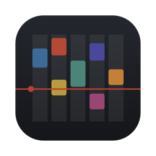
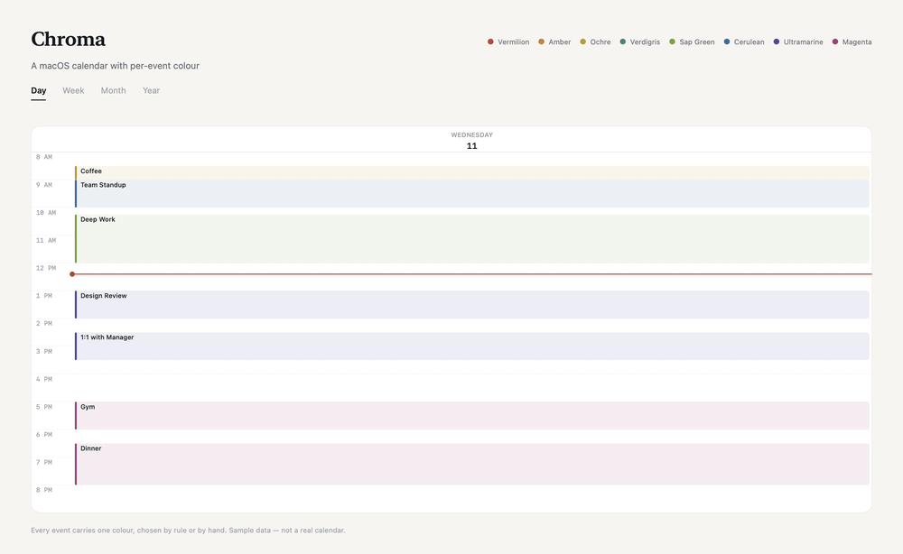

<p align="center">
  
</p>

# Chroma

A macOS calendar over EventKit, with the one feature Apple's own app refuses
to have: per-event colours. Day, week, month and year views. Builds with the
Swift compiler from the Command Line Tools — no Xcode project, no
dependencies.



*Sample data throughout — not a real calendar.*

## Requirements

- **A Mac running macOS 14 Sonoma or later** — Apple silicon or Intel.
  Chroma is Mac-only: there is no iPhone, iPad, Windows, Linux or web version.
  It's built entirely on macOS frameworks — EventKit for the calendar data,
  SwiftUI and AppKit for the interface, Carbon for the system-wide shortcuts —
  and earlier versions of macOS won't open it, because the calendar-access API
  it relies on arrived in Sonoma.
- **Your calendars set up in macOS.** Chroma shows what your Mac already syncs.
  Add iCloud, Google, Exchange or CalDAV accounts in **System Settings ›
  Internet Accounts**. If a calendar appears in Calendar.app, Chroma can show it.
- **Optional: [Claude Code](https://claude.com/claude-code)**, for Ask Claude.
  Everything else works without it.
- **To build from source:** the Xcode Command Line Tools
  (`xcode-select --install`). Xcode itself isn't needed.

## Quick start

1. **Download** `Chroma.zip` from the
   [latest release](https://github.com/ruben-hayrapetyan/chroma/releases/latest),
   unzip it, and drag **Chroma** into **Applications**.
2. **Allow it to open.** Chroma isn't notarized by Apple, so macOS blocks the
   first launch with a warning that it couldn't verify the app. Open **System
   Settings › Privacy & Security**, scroll down to **Security**, and click
   **Open Anyway** next to Chroma. You only do this once. (Or, in Terminal:
   `xattr -dr com.apple.quarantine /Applications/Chroma.app`.)
3. **Allow calendar access** when Chroma asks.
4. **Choose your main calendar** — the one new events go to. If yours isn't
   listed, add its account in **System Settings › Internet Accounts** and it
   appears.

That's it. Right-click any event to give it a colour, or press `⌥Space` from
any app to add one. When you're ready for more, **Chroma › Settings** (`⌘,`)
connects other calendars to show alongside, and opens the category rules that
colour events automatically. Ask Claude (`⌃Space`) needs
[Claude Code](https://claude.com/claude-code) installed and signed in to your
own Claude account — run `claude` once in Terminal to sign in.

To update, replace the app in Applications. macOS may ask for calendar access
again, since it treats each unsigned build as a new app.

## Build from source

```bash
./build.sh
```

Produces `build/Chroma.app` — universal, for Apple silicon and Intel — renders
the icon, writes `Info.plist`, and ad-hoc signs the bundle. `ARCHS=arm64
./build.sh` builds for one architecture only, in half the time. Install with:

```bash
cp -R build/Chroma.app /Applications/
```

The first launch asks for Calendar access. Because the bundle is ad-hoc signed,
macOS may ask again after a rebuild — the signature changes, so TCC reads it as
a different app.

`./release.sh` builds and packages `build/Chroma.zip` for a GitHub release,
archived with `ditto` so the signature survives the download.

## What it does

**Your calendars, whichever account they're on.** Chroma never signs in to
anything. It reads the calendars macOS already syncs — iCloud, Google, Exchange,
any CalDAV server — so connecting an account means adding it in **System
Settings › Internet Accounts**, then granting Chroma calendar access when it
asks.

On first launch Chroma asks which calendar is your **main calendar**: the one
new events go to, and the only one Claude can change. Change it later in
**Chroma › Settings › Calendars** (`⌘,`). It's remembered by identifier, with its
title and account as a fallback, so a rename elsewhere doesn't lose it; if it
disappears from the Mac altogether, the picker comes back.

**Other calendars, on toggles.** Tick any other calendar in Settings to draw it
alongside the main one — a shared calendar, a subscription, a room-booking
calendar. Each is switched on and off from the stack button in the toolbar or
the **View** menu (`⌥⌘1`–`⌥⌘9`), and the choice persists. Tick **Toolbar
button** beside one in Settings to give it a one-click button of its own: its
colour swatch, solid while shown and hollow while hidden. While shown, their
events join search and Claude's snapshot, but new events never go there and
Claude can't change them. Read-only calendars open in the inspector without
Edit or Delete. Give a connected calendar a colour and every event on it takes
that pigment, ahead of the category rules — for calendars whose titles say
nothing about what kind of event they are.

**Live in both directions.** There is no sync layer, because there is nothing to
sync: the app talks to the same EventKit database Calendar.app does. An event
added here shows up in Calendar.app and on your other devices; an event added there — or by
Claude, or arriving from another device — appears here the moment it lands. The
app listens for `EKEventStoreChanged` and reloads.

**Four views.** Day and week share one hour grid, with overlapping events packed
into columns the way Google Calendar does it and a live "now" line. Month is a
six-week grid that never changes height. Year is twelve mini months; click a day
to drop into it.

**Categories.** Every event belongs to one category, each with its own pigment,
matched by title. The rules live in
`~/Library/Application Support/Chroma/categories.json`, so your real course
numbers, clubs and employers stay on your Mac and out of the app. On first
launch the file is written with a small generic set:

| Category | Pigment |
| --- | --- |
| Deadlines & assignments | Vermilion |
| Classes | Cerulean |
| Professor office hours | Sap Green |
| Office hours & advising | Verdigris |
| Professional meetings | Ultramarine |
| Club meetings | Amber |
| Campus events | Ochre |
| Social | Magenta |

Edit it in any text editor — **Settings › Categories** opens it. Each event takes
the first category whose `pattern` matches its title: a regular expression,
matched ignoring case. In JSON a backslash is written twice, so a word boundary
is `\\b`. `color` is a pigment id or name: `red` (Vermilion), `orange` (Amber),
`yellow` (Ochre), `green` (Verdigris), `sapgreen` (Sap Green), `blue`
(Cerulean), `purple` (Ultramarine), `pink` (Magenta), `graphite` (Payne's Grey),
`violet` (Cobalt Violet). `note` is ignored — JSON has no comments, so that's
where to say why a rule is the way it is.

```json
{
  "categories": [
    {
      "name": "Professor office hours",
      "slug": "faculty",
      "color": "sapgreen",
      "pattern": "office hours — prof\\."
    },
    {
      "name": "Office hours & advising",
      "slug": "advising",
      "color": "Verdigris",
      "pattern": "office hours|advising|drop.?in"
    }
  ],
  "filter": {
    "label": "TA Office Hours",
    "pattern": "office hours|drop.?in",
    "except": ["faculty"]
  }
}
```

The optional `filter` hides matching events behind an eye button in the
toolbar and **View › Show …** (`⇧⌘O`), for whatever crowds out the rest of a
week. Categories listed in `except` are never hidden, even when the title
matches. With no filter, there's no button and nothing is hidden.

Changes apply when you switch back to Chroma. A file that doesn't parse leaves
the last good rules in place, and Settings says what's wrong and where.

Categorising happens on its own: the first reload after launch covers the whole
calendar, and every reload after that catches whatever just arrived — from
Claude, from Calendar.app, from another device. Events coloured by hand in the
inspector are never overwritten. **Organize › Assign Categories to Everything**
(`⇧⌘K`) re-runs the rules over the entire calendar and *does* overwrite hand
choices, which is the point of asking for it.

Claude assigns a category to anything it creates, from the slugs in
`categories.json`. It cannot reach the app's
colour store through AppleScript, so it writes a marker — `[chroma: club]` — on
the last line of the event's notes, and the app reads it. An explicit marker
beats the title rules, so it also travels with the event to your other devices.

**Search.** `⌘F`, or the field at the top of the sidebar. Matches are ranked by
how well they hit the title — exact, then prefix, then word-start, then
substring, then scattered subsequence — and within a tier what you can reach
soonest comes first: upcoming before past, soonest first among the upcoming.
Repeating events collapse to one row — the **next** occurrence, not the last. Clicking a result takes the view to that date
and opens it in the inspector.

**Clicking an event opens an inspector** on the right; double-clicking opens it
already in edit mode. Title, all-day, start, end, location and notes are all
editable in the pane, and colour applies the moment you pick it. There is no
modal sheet anywhere in the app — a sheet would cover the calendar, which is the
thing you want in view while moving an event's time.

**Per-event colours.** EventKit has no per-event colour, so these live in a
sidecar at `~/Library/Application Support/Chroma/colors.json`, keyed by the
event's identifier. Two consequences, neither avoidable:

- Colours are local to this Mac. They do not reach iCloud, your iPhone, or
  Calendar.app.
- A repeating event takes one colour for the whole series, since every
  occurrence shares an identifier.

Set one in the event editor, or right-click any event anywhere in the app.

**Repeats are editable.** Both the create pane and the inspector carry a repeat
control — frequency, interval, weekdays for weekly, and an end that is either a
date or a number of occurrences. Clearing it back to Never removes the repeat.

**Recurring events are expanded.** Every occurrence lands on its own date, which
is what the `.ics` export could not manage.

## Keyboard

| Shortcut | Does |
| --- | --- |
| `⌘1` `⌘2` `⌘3` `⌘4` | Day / Week / Month / Year |
| `⌘N` | New event on the selected day |
| `⌥Space` | Same, from any app — brings Chroma forward first |
| `⌃Space` | Ask Claude, from any app |
| `⌘F` | Search events |
| `⇧⌘K` | Organize › Assign Categories to Everything |
| `⇧⌘O` | Show or hide filtered events (when `categories.json` has a filter) |
| `⌥⌘1`–`⌥⌘9` | Show or hide the first nine connected calendars |
| `⌘,` | Settings — main calendar, connected calendars, categories file |
| `⌘T` | Today |
| `⌘←` / `⌘→` | Previous / next period |

The two `Space` combinations are system-wide. They use Carbon's
`RegisterEventHotKey` rather than an `NSEvent` monitor, so the app never asks for
Accessibility permission.

Modifier+Space keeps them one-handed and avoids taking a letter combination away
from every other app. Raycast holds `⇧⌘Space` and Spotlight `⌘Space`, so neither
of these collides. Note that `⌃Space` is also macOS's "previous input source"
switcher when more than one input source is installed.

## Ask Claude

`⌃Space`, or the sidebar button, opens a panel inside the app. Type a request in
plain language, press `⌘↩`, and the response streams back in place.

It runs your own [Claude Code](https://claude.com/claude-code) install, signed in
to your own account. Chroma never sees or stores a Claude login, and requests
count against that account's plan like any other Claude Code use. Chroma looks
for the `claude` command in `~/.local/bin`, `/opt/homebrew/bin` and
`/usr/local/bin`; without it the button is disabled and everything else works
as normal.

Sign in by running `claude` once in Terminal. An API key exported only in a
shell profile (`ANTHROPIC_API_KEY` in `~/.zshrc`) won't reach it: apps opened
from Finder don't read shell profiles, so Chroma's copy of the CLI never sees
the variable.

**What leaves your Mac.** Ask Claude is the only part of Chroma that sends
anything anywhere. Each request includes the snapshot below — the title, time,
location and category of every event on the calendars being shown, five months
back to seven ahead — and goes to Anthropic through the CLI, under your
account's terms. Event notes are not included. Nothing is sent until you press
Send.

**Claude has no tools.** It never touches the calendar itself. The prompt carries
a numbered snapshot of your events — the year around the day in view, five months
back and seven ahead — and Claude replies with a sentence for you plus a JSON
plan:

```json
{"operations":[{"op":"create","title":"Office Hours",
  "start":"2026-09-08T15:00","end":"2026-09-08T16:00","category":"advising",
  "location":"Room 210",
  "recurrence":{"freq":"weekly","interval":1,"byDay":["TU"],"until":"2026-12-19"}}]}
```

Chroma applies that through EventKit and lists what changed. `update` and
`delete` refer to events by their number in the snapshot. Events from other
calendars are marked read-only in it; a plan that tries to change one is
refused, so a shared calendar can't lose someone else's booking to a wrong guess.

This replaced an earlier design where Claude drove Calendar.app over AppleScript.
That approach launched Calendar.app and left it in the Dock, made every date
locale-dependent, and could hang for minutes on an unbounded query. Handing back
a plan instead removes all three problems, and the tool allowlist along with them.

Repeating events can be changed one occurrence at a time — `"occurrences":
["2026-09-02","2026-09-09"]` on an update or delete affects only those dates.
Leave it off and the change applies to the whole series.

Repeating events appear once in the snapshot rather than as every occurrence.
Expanded, a term of one thrice-weekly lecture is forty-five lines on its own;
collapsed, the whole year fits in about a hundred and fifty. Nothing is lost,
since editing a repeating event applies to the series either way.

## Layout

| File | Holds |
| --- | --- |
| `Sources/EventStore.swift` | EventKit access, main and connected calendars, fetching, create/update/delete, search ranking |
| `Sources/Categories.swift` | Loading `categories.json`, matching, the filter, and the colouring pass |
| `Sources/SettingsView.swift` | Settings window — main and connected calendars, the categories file |
| `Sources/CalendarChooser.swift` | The first-launch calendar picker |
| `Sources/Recurrence.swift` | The repeat control shared by the create and edit panes |
| `Sources/ViewMode.swift` | The four zoom levels and their date maths |
| `Sources/Theme.swift` | Design tokens, the mode picker, the glyph button |
| `Sources/EventColors.swift` | The colour palette and its sidecar file |
| `Sources/EventChip.swift` | The pale-block-with-pigment-spine event treatment |
| `Sources/EventLayout.swift` | Column packing for overlapping events |
| `Sources/ContentView.swift` | Window chrome, sidebar, search, agenda |
| `Sources/DetailPane.swift` | The inspector, read and edit |
| `Sources/NewEventPane.swift` | The create form |
| `Sources/MonthView.swift` | Month grid |
| `Sources/TimeGridView.swift` | Day and week grids |
| `Sources/MiniMonth.swift` | Mini months and the year view |
| `Sources/ClaudePanel.swift` | The Claude popup and its CLI runner |
| `Sources/ClaudePlan.swift` | Parses Claude's reply and applies it through EventKit |
| `Sources/GlobalHotKey.swift` | Carbon system-wide shortcuts |
| `Sources/ChromaApp.swift` | Entry point, menus, hotkey registration |
| `tools/MakeIcon.swift` | Renders the app icon |
| `tools/RenderReadmeArt.swift` | Renders the images in this README from synthetic sample data |

## Known limits

- Editing a repeating event applies to this and all future occurrences; there is
  no "just this one".
- No drag to move or resize an event yet — use the editor.
- Colours are not backed up. Deleting `colors.json` resets every event to
  untagged.

## The design

**The chrome refuses colour so the content can own it.** Chroma exists because
per-event colour carries meaning; a tinted interface competes with the thing it
frames. Every structural element is ink or paper, and saturation is spent
entirely on events. One hue is reserved: the red now-line, because "you are
here" is the only other thing worth a colour.

The vocabulary is a printed course timetable — a serif for headings, a
monospace for the hour gutter and every date and time, hairline rules, and
events set as pale blocks with a solid pigment spine down one edge, the way a
swatch card shows its colour. The spine is deliberate: tinted fills wash out at
the sizes a month grid forces, but three saturated pixels hold their hue at any
size.

Pigments are named as pigments — Vermilion, Amber, Ochre, Verdigris, Sap Green,
Cerulean, Ultramarine, Magenta, Payne's Grey, Cobalt Violet — because naming them properly is
most of what makes choosing one feel like a decision. Their stored ids are unchanged
from the first version, so renaming them orphaned nothing. Untagged events are a
neutral slate: if they were coloured, colour would stop meaning anything.

All tokens live in `Sources/Theme.swift`.
